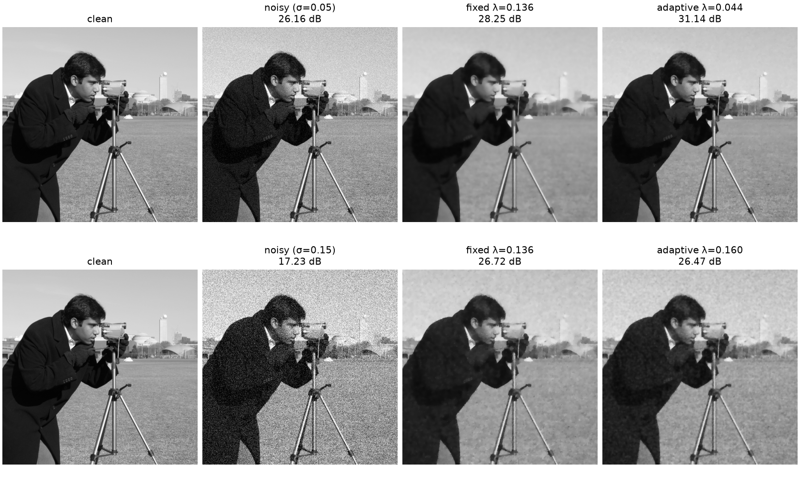
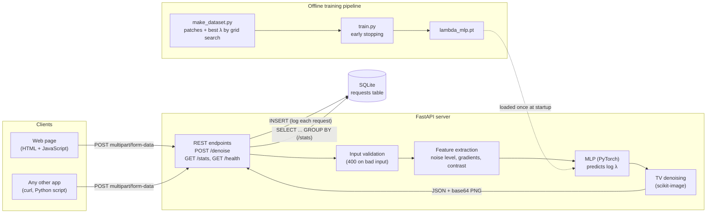
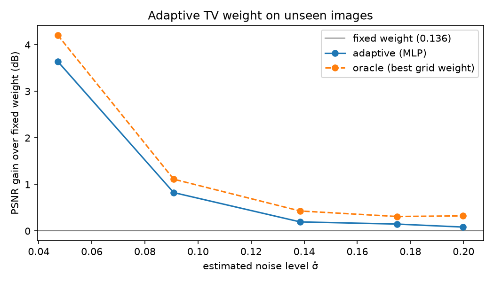

# Adaptive Denoise

An image-denoising service where a small neural network chooses the
**Total Variation (TV) regularisation strength λ for each image**, instead of
using one fixed value for every input.



## Motivation

TV denoising removes noise while keeping edges sharp, but its result depends
heavily on λ: too small and noise remains, too large and the image becomes
flat and "cartoon-like". The best λ changes with the noise level and the
image content, so a single hand-picked value is a compromise.

During my research internship at UCL I worked on learning TV regularisation
parameters using Fenchel–Young losses. This is an independent personal
project exploring the same question with a simpler, fully supervised approach,
and turning it into a usable tool.

## How it works

1. **Training data**: random 128×128 patches from scikit-image sample images,
   corrupted with Gaussian noise (σ between 0.02 and 0.25). For each patch,
   25 log-spaced values of λ are tried and the one with the highest PSNR is
   kept as the label.
2. **Features**: the model sees only the noisy image, summarised by
   3 features: estimated noise level (wavelet-based), mean gradient magnitude,
   and intensity standard deviation.
3. **Model**: a small MLP (3 → 16 → 16 → 1) trained in PyTorch to predict
   **log(λ)**, so predictions are always positive after `exp()`.
   Features are standardised with training statistics, and early stopping
   on a validation split prevents overfitting.
4. **Serving**: a FastAPI service exposes `/denoise`. With
   `method=tv_adaptive` the model predicts λ, then TV denoising runs with it.
   A small web page calls the API and shows the methods side by side.
5. **Monitoring**: every successful request is logged to a SQLite database,
   and `/stats` summarises usage, runtimes and the λ values the model chooses.

## Architecture



The web page is a client like any other: it only talks to the server over
HTTP and has no direct access to the model or the database.

## Results

Evaluated on **80 patches from 2 images never used in training**
(`camera`, `coins`). The fixed baseline is the single λ with the best
average PSNR on the *training* set (λ = 0.136).

| Method | Mean PSNR (dB) |
|---|---|
| Noisy input | 18.95 |
| TV, fixed λ | 25.87 |
| **TV, adaptive λ (MLP)** | **26.85** |
| TV, oracle λ (best of grid, needs clean image) | 27.14 |

- Adaptive λ closes **77%** of the gap between the fixed baseline and the oracle.
- It beats the fixed λ on **74%** of test patches.
- The gain is largest at low noise, where a fixed λ over-smooths:



## Quick start

```bash
python3 -m venv .venv
source .venv/bin/activate
pip install -r requirements.txt

uvicorn api.main:app --reload
```

- Web page: http://127.0.0.1:8000/
- Interactive API docs: http://127.0.0.1:8000/docs
- Usage statistics: http://127.0.0.1:8000/stats

To reproduce the model and results:

```bash
python -m scripts.make_dataset   # build training/test data
python -m scripts.train          # train the MLP
python -m scripts.evaluate       # metrics + results/eval.png
pytest -v                        # run the tests
```

## Using the API from another application

```bash
curl -X POST http://127.0.0.1:8000/denoise \
  -F "file=@noisy.png" \
  -F "method=tv_adaptive"
```

Response (JSON):

```json
{
  "method": "tv_adaptive",
  "param": 0.1046,
  "param_source": "predicted",
  "shape": [512, 512],
  "runtime_ms": 26.8,
  "image_png_base64": "..."
}
```

| Endpoint | Description |
|---|---|
| `POST /denoise` | Denoise an image. `method`: `gaussian` (param = blur σ), `tv` (param = λ), `tv_adaptive` (λ predicted) |
| `GET /stats` | Request counts, average runtime and average λ per method; number of requests outside the training noise range |
| `GET /health` | Liveness check |

## Request logging (SQLite)

Each successful `/denoise` call is stored as one row in the `requests` table
(`data/requests.db`). Images themselves are not stored, only metadata:

| Column | Type | Meaning |
|---|---|---|
| `id` | INTEGER | Primary key, auto-incremented |
| `created_at` | TEXT | UTC timestamp (ISO 8601) |
| `method` | TEXT | `gaussian`, `tv` or `tv_adaptive` |
| `param` | REAL | Parameter used (λ for TV; predicted λ for `tv_adaptive`) |
| `sigma_hat` | REAL | Estimated noise level of the uploaded image |
| `height`, `width` | INTEGER | Image size in pixels |
| `runtime_ms` | REAL | Processing time |

Queries are parameterised. Logging `sigma_hat` makes it possible to detect
**data drift**: requests with σ̂ above the training range (0.25) are counted
by `/stats`.

## Project structure

```
denoise/    core algorithms, feature extraction, model definition
api/        FastAPI service and SQLite request log
static/     web page (HTML + JavaScript client of the API)
scripts/    dataset generation, training, evaluation
tests/      unit and API tests
models/     trained model weights
results/    evaluation charts
```

## Limitations and future work

- **High noise**: gains are small at high noise levels; the gradient
  feature is dominated by noise there. Noise-robust features (e.g. gradients
  of a pre-smoothed image) or a small CNN on the pixels could help.
- **Low noise / clean images**: real uploads are often cleaner than the
  training range (σ ≥ 0.02), so the model extrapolates below the smallest λ
  it was trained on. Widening the training range and also flagging low-σ̂
  requests in `/stats` would address this.
- **Metric**: PSNR does not fully match perceived quality. Two values of λ
  can have the same PSNR but keep different amounts of texture. Evaluating
  (or training) with SSIM is a natural next step.
- **TV itself** loses fine texture even at the best λ; stronger denoisers
  (non-local means, BM3D, learned denoisers) would raise the ceiling.
- **Security**: there is no authentication; this is a local demo. A real
  deployment would need API keys or user authentication, served over HTTPS.
- Grayscale only, Gaussian noise only, trained on 128×128 patches.
- Small test set (2 images); more held-out images would give tighter estimates.

## How this was built

I used Claude and ChatGPT as coding assistants throughout this project.
I chose the problem, designed the experiments and the evaluation protocol,
and made the design decisions; I reviewed, ran and tested all of the code.