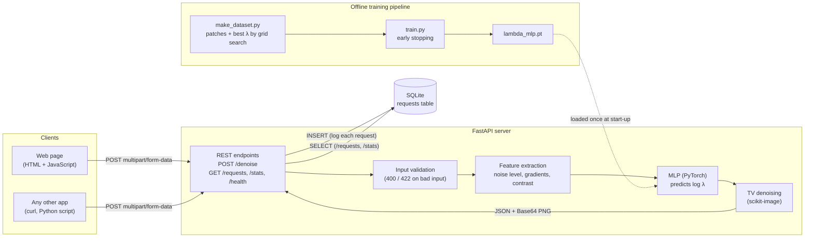

# Adaptive Denoise

An image-denoising application in which a small neural network selects the
regularisation weight **λ** for Total Variation (TV) denoising, separately for
each image. The project combines a supervised learning pipeline with a REST
API, a SQLite request log and a web interface for comparing methods.


*Unseen test image. With light noise (top), the adaptive λ keeps more detail
than the fixed one (+2.9 dB).*

## Motivation

During my research internship at UCL, I worked on learning regularisation
parameters for TV denoising using Fenchel-Young losses. I decided to revisit
the problem independently using a simpler supervised learning approach.

TV denoising requires balancing noise removal against preserving image
detail. If the regularisation weight is too low, noise remains in the image;
if it is too high, important details can be lost. The aim of this project is
to predict a suitable weight based on the characteristics of the noisy image,
rather than relying on a fixed, manually selected value.

I also wanted to explore how this type of image-processing model could be
incorporated into a standalone application and accessed through an API.

## Method

### Dataset generation

From each scikit-image sample image, 40 random 128 × 128 patches are
extracted and corrupted with Gaussian noise of standard deviation σ between
0.02 and 0.25. Each noisy patch is then denoised with 25 log-spaced values of
λ between 0.01 and 0.5, and the value giving the highest PSNR against the
clean patch becomes the training target.

Two images (`camera`, `coins`) are held out completely for testing, so that
patches from the same photograph never appear in both training and test sets.

### Features and model

The model uses three features extracted from each noisy patch:

- estimated noise standard deviation (wavelet-based estimator),
- mean gradient magnitude, to capture edges and texture,
- intensity standard deviation, to capture contrast.

A PyTorch MLP (`3 → 16 → 16 → 1`) is trained to predict **log λ**. Predicting
log λ makes it easier to handle different weight values and ensures λ is
positive after exponentiation. Features are standardised using
training-set statistics only, and early stopping on a validation split keeps
the weights from the epoch with the lowest validation loss.

### API and web interface

The FastAPI backend provides a `/denoise` endpoint. It supports three methods:

| Method | Description |
|---|---|
| `gaussian` | Gaussian blur; the client sets the blur strength (`param`) |
| `tv` | TV denoising with a client-supplied λ (`param`) |
| `tv_adaptive` | TV denoising with λ predicted by the MLP |

The endpoint accepts an uploaded image and returns JSON containing the
denoised image (Base64-encoded PNG), the λ used and whether it was predicted,
the image dimensions and the processing time. The model is loaded once at
start-up, not on every request.

The web interface (HTML and JavaScript) uploads an image, runs the three
methods in parallel and displays the results side by side, followed by a live
table of recent requests read from the database. The web interface communicates with the backend through HTTP, using the same
endpoints available to external applications.

### Request logging

Every successful request is stored as one row in a SQLite table. Uploaded
images are not retained; only metadata is logged:

| Column | Type | Description |
|---|---|---|
| `id` | INTEGER | Primary key, auto-incremented |
| `created_at` | TEXT | UTC timestamp (ISO 8601) |
| `method` | TEXT | `gaussian`, `tv` or `tv_adaptive` |
| `param` | REAL | Parameter used (the predicted λ for `tv_adaptive`) |
| `sigma_hat` | REAL | Estimated noise level of the uploaded image |
| `height`, `width` | INTEGER | Image size in pixels |
| `runtime_ms` | REAL | Processing time in milliseconds |

All queries are parameterised. The estimated noise level is also logged to identify
requests outside the training distribution; `/stats` reports how many there are.

## Architecture



Training runs offline and produces a model file; the server only performs
inference. The denoising algorithms, feature extraction, API handling and request
logging are implemented in separate modules.

## Results

Evaluation uses 80 patches from the two held-out images. Three ways of
choosing λ are compared:

- **Fixed:** the single λ with the highest mean PSNR on the *training* set (0.136).
- **Adaptive:** λ predicted per patch by the MLP.
- **Oracle:** the best of the 25 grid values for each patch, found using the
  clean image. It is not available in practice and serves as an upper bound.

| Method | Mean PSNR (dB) |
|---|---:|
| Noisy input | 18.95 |
| TV, fixed λ | 25.87 |
| **TV, adaptive λ (MLP)** | **26.85** |
| TV, oracle λ | 27.14 |

- The adaptive model improves PSNR by **0.98 dB** over the fixed baseline and
  recovers **77%** of the gap to the oracle.
- It outperforms the fixed λ on **74%** of test patches.
- The largest gains occur at low noise levels, where the fixed λ over-smooths.
  At high noise the fixed value is already close to optimal and the gain is small.


These results apply to synthetic Gaussian noise and two held-out images.

## Installation

```bash
python3 -m venv .venv
source .venv/bin/activate
pip install -r requirements.txt
uvicorn api.main:app --reload
```

- Web interface: http://127.0.0.1:8000/
- Interactive API documentation: http://127.0.0.1:8000/docs
- Request statistics: http://127.0.0.1:8000/stats

### Reproducing the experiments

```bash
python -m scripts.make_dataset   # generate training and test data
python -m scripts.train          # train the MLP
python -m scripts.evaluate       # compute metrics and results/eval.png
pytest -v                        # run the test suite
```

## API usage

```bash
curl -X POST http://127.0.0.1:8000/denoise \
  -F "file=@noisy.png" \
  -F "method=tv_adaptive"
```

Example response (image data abbreviated):

```json
{
  "method": "tv_adaptive",
  "param": 0.1046,
  "param_source": "predicted",
  "shape": [512, 512],
  "runtime_ms": 26.8,
  "image_png_base64": "..."
}
```

| Endpoint | Description |
|---|---|
| `POST /denoise` | Denoise an uploaded image with the chosen method |
| `GET /requests?limit=20` | Most recent logged requests (limit between 1 and 100) |
| `GET /stats` | Request counts, mean runtime and mean λ per method; requests outside the training noise range |
| `GET /health` | Health check |

## Project structure

```text
denoise/    denoising methods, feature extraction, MLP definition
api/        FastAPI endpoints and SQLite logging
static/     web interface (HTML + JavaScript)
scripts/    dataset generation, training, evaluation
tests/      unit and API tests
models/     trained model weights
results/    evaluation figures
```

## Limitations and future work

**Generalisation.** The model is trained on synthetic Gaussian noise and
128 × 128 patches. Its behaviour on real camera noise and other noise
distributions has not been evaluated.

**High noise.** At high noise levels the gradient feature mostly measures
noise rather than image structure, which limits the gain. Computing gradients
on a pre-smoothed image, or replacing the hand-crafted features with a small
convolutional network, could help.

**Low noise.** Training starts at σ = 0.02, but real uploads are often
cleaner, so the model extrapolates below the smallest λ it was trained on.
Widening the training range and flagging low-noise requests in `/stats` would
address this.

**Evaluation.** PSNR does not fully reflect perceived quality: two values of λ
can give similar PSNR while preserving different amounts of texture. SSIM and
a larger held-out set would give a more complete picture.

**Concurrency.** The CPU-intensive denoising call runs synchronously inside
an asynchronous endpoint, so it blocks the event loop of its worker process
while it runs. With the default single Uvicorn worker, requests are therefore
effectively handled one after another. Moving this work to a thread or
process pool, or running several workers, would allow concurrent processing.

**Deployment.** The application is designed for local use. A production
deployment would need authentication, HTTPS and limits on upload size.

## Development

This is an independent project inspired by my UCL research internship. The
internship used a Fenchel-Young-based approach; here the model is trained by
supervised regression on grid-search targets, and all code was written for
this project.

Claude and ChatGPT were used as coding assistants throughout development,
mainly for code suggestions and debugging. I was responsible for the project's
design, experiments, testing and evaluation, and I reviewed and ran all of the
code.
